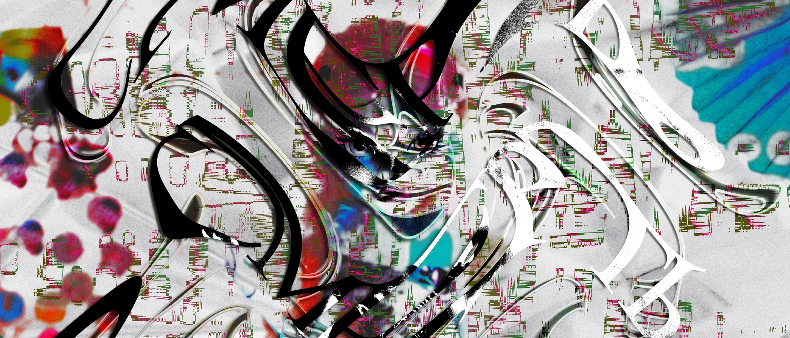
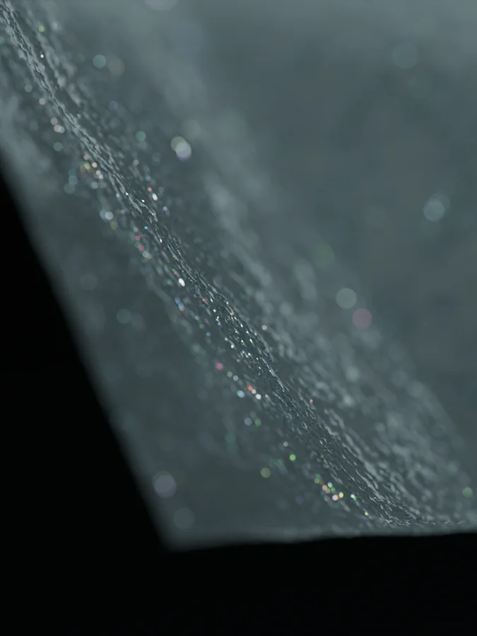
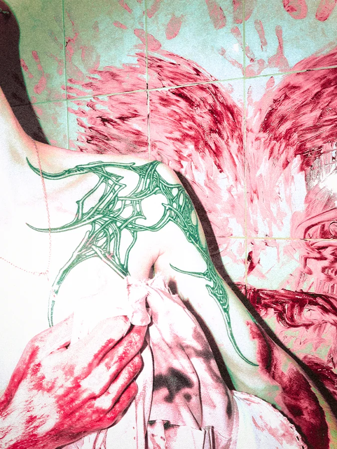
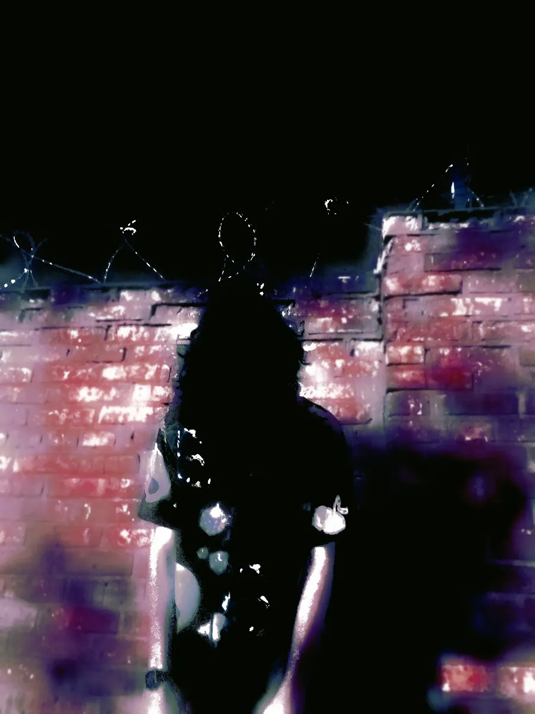
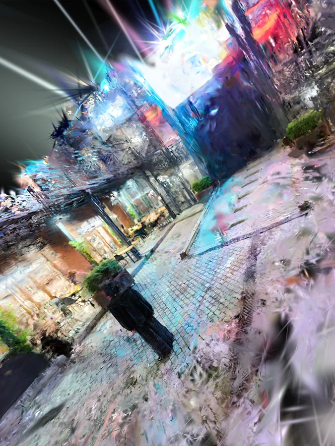

# constantchoice

**Interactive Visual Portfolio**

3D · Motion Design · Digital Art · Photography

 

## About

An interactive creative portfolio showcasing visual experiments, 3D projects, motion graphics, photography and digital artwork

Designed as an immersive visual experience, combining custom animations, interactive elements and experimental interfaces

 

## Selected Projects

<table>
  <tr>
    <td width="50%" align="center" valign="top">
      
       <strong>MONUMENTAL</strong> 
      3D Cinematic · Brutalism
    </td>
    <td width="50%" align="center" valign="top">
      
       <strong>PINK BLOOD</strong> 
      Editorial Photography
    </td>
  </tr>
  <tr></tr> 
  <tr>
    <td width="50%" align="center" valign="top">
      
       <strong>CARTOONS</strong> 
      Photography · Visual Art
    </td>
    <td width="50%" align="center" valign="top">
      
       <strong>ZAKHAR</strong> 
      3D · Photogrammetry
    </td>
  </tr>
</table>

 

## Performance

  
### Wired connection (no throttling)

| Metric | v1 | v2 | v3 | Change (v2 → v3) |
|--------|:--:|:--:|:--:|------------------|
| **Data transferred** | 47.7 MB | 45.2 MB | 18.2 MB | ✅ -27.0 MB |
| **Resources** | 48.2 MB | 45.9 MB | 19.0 MB | ✅ -26.9 MB |
| **Requests** | 460 | 394 | 132 | ✅ -262 |
| **DOMContentLoaded** | 212 ms | 530 ms | 186 ms | ✅ -344 ms |
| **Load** | 214 ms | 534 ms | 189 ms | ✅ -345 ms |
| **Finish** | 3.34 s | 2.36 s | 6.72 s | ❌ +4.36 s |

### Fast 4G (emulated)

| Metric | v1 | v2 | v3 | Change (v2 → v3) |
|--------|:--:|:--:|:--:|------------------|
| **Data transferred** | 47.7 MB | 45.2 MB | 18.2 MB | ✅ -27.0 MB |
| **Resources** | 48.2 MB | 45.9 MB | 19.0 MB | ✅ -26.9 MB |
| **Requests** | 460 | 394 | 132 | ✅ -262 |
| **DOMContentLoaded** | 927 ms | 859 ms | 872 ms | ❌ +13 ms |
| **Load** | 929 ms | 861 ms | 875 ms | ❌ +14 ms |
| **Finish** | 51.05 s | 47.95 s | 19.50 s | ✅ -28.45 s |

 

 JavaScript · HTML5 · CSS3 · Three.js · CesiumJS · D3.js 

---

  <a href="https://constantchoice.github.io/constantchoice-portfolio/">
    ✦&nbsp; web · constantchoice.github.io &nbsp;✦
  </a>

